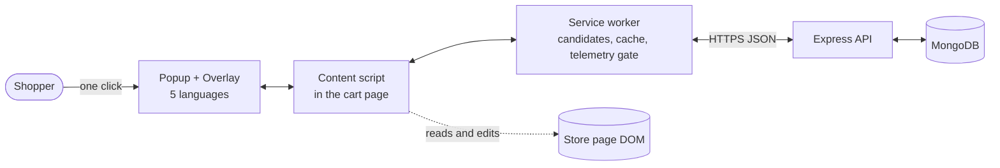
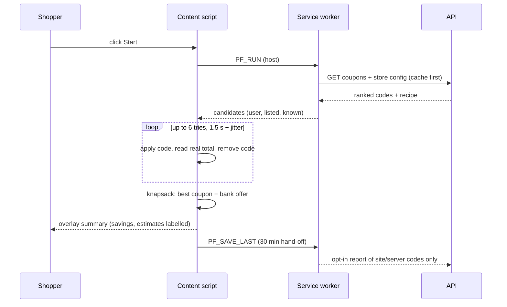

# Promo-Flow: System Architecture

Promo-Flow is a Manifest V3 browser extension (Chrome/Edge) for Indian shoppers, plus a small Node/Express + MongoDB backend. On one user click at a cart or checkout page it tries known coupon codes one at a time, reads the real payable total after each, and recommends the best allowed combination: at most one coupon and one bank/payment offer per cart. Bank offers are estimates and are never applied.

## 1. Context diagram

## 2. Components

| Layer | Component | Responsibility |
|---|---|---|
| Extension | `src/popup/*` | Start/stop, language dropdown, Diagnose (sanitized page snapshot) |
| Extension | `src/ui/overlay.js` | Shadow-DOM overlay: progress, summary, payment advice, notes |
| Extension | `src/content/contentScript.js` | Injected on click (`activeTab` + `scripting`), no content scripts in the manifest; handles START/STOP/PING/CAPTURE |
| Extension | `src/content/applyEngine.js` | `runSearch`: one trial loop for every site |
| Extension | `src/content/drivers.js` | `genericDriver` and `recipeDriver` behind one interface |
| Extension | `src/adapters/recipe.js` | Strict recipe validator, locators, page kind |
| Extension | `src/background/serviceWorker.js` | Candidate lists, recipe cache, hand-off store, telemetry |
| Extension | `src/background/candidates.js` | `buildCandidates`, `mergeCandidates`, `TtlCache` |
| Extension | `src/algorithms/*` | Trie, MaxHeap, MinHeap, grouped knapsack |
| Backend | `backend/app.js` | Routes, validation (zod), helmet, CORS, rate limits |
| Backend | `backend/ranking.js` | Wilson lower-bound ranking of coupons |
| Backend | `backend/recipes.js` | Loads and validates data-only site recipes |
| Backend | `backend/repo/*` | Memory repo (default) and MongoDB repo behind one interface |

## 3. One run, step by step

Stops, hands-off and without a final re-apply: login wall, CAPTCHA, rate-limit wording, panel unavailable, user abort.

## 4. Algorithms and where they sit

| Structure | Location | Job |
|---|---|---|
| Trie | `Trie.js` | Try/success counters per code, prior for unseen codes |
| MaxHeap | `Heap.js` | Top-K candidates, best first |
| MinHeap | `Heap.js` | Expiry order of the TTL cache (persisted, restored on wake) |
| Grouped knapsack DP | `knapsack` | Best pick across the coupon group and the offer group; validated against brute force on 400 random cases |
| Wilson lower bound | `ranking.js` | Fair server ranking when a code has few reports |

All money is integer paise. A saving is only ever a difference of measured page totals; bank-offer figures are labelled estimates.

## 5. Backend API

| Method and path | Purpose |
|---|---|
| `GET /health` | Status and repo kind |
| `GET /api/v1/coupons/:domain` | Ranked known codes for a store |
| `POST /api/v1/coupons/report` | Opt-in outcome report (applied, invalid, expired, min_spend_not_met, not_applicable, no_effect) |
| `GET /api/v1/stores/:domain/config` | Store record plus validated recipe |

Data: `stores` (one per host, optional `recipe`) and `coupons` (domain, code, counters). Recipes are re-validated before they are served and again by the extension, because they are data the extension acts on.

## 6. Security and compliance design

- Runs only on a user click; no host permissions; no background scraping.
- Pacing: 6 tries, 1.5 s delay plus 0 to 1 s jitter; hands off on login or CAPTCHA.
- Telemetry gate: only codes from the server, seed or the site's own list are reported; the user's own codes never are. Minimal, opt-in (DPDP).
- Never reads card data (RBI); payment pages get read-only advice.
- No affiliate links; estimates labelled; no false urgency.
- Recipes: unknown keys dropped, plain substring matching, no regex built from data.
- Not legal advice.

## 7. Site support status

| Site | Status |
|---|---|
| Local demo store (simple box, popup list, payment) | Verified in jsdom and real Chromium |
| Amazon.in, Flipkart | Legacy adapters, unverified |
| Myntra, Ajio, Nykaa | Not supported until real page captures exist (milestone M6) |

## 8. Build and test

esbuild bundles `background.js` (ESM), `content.js` and `popup.js` (IIFE) into `dist/`. Tests: vitest + jsdom + supertest, 107 tests in 10 files. The MongoDB path is untested.
