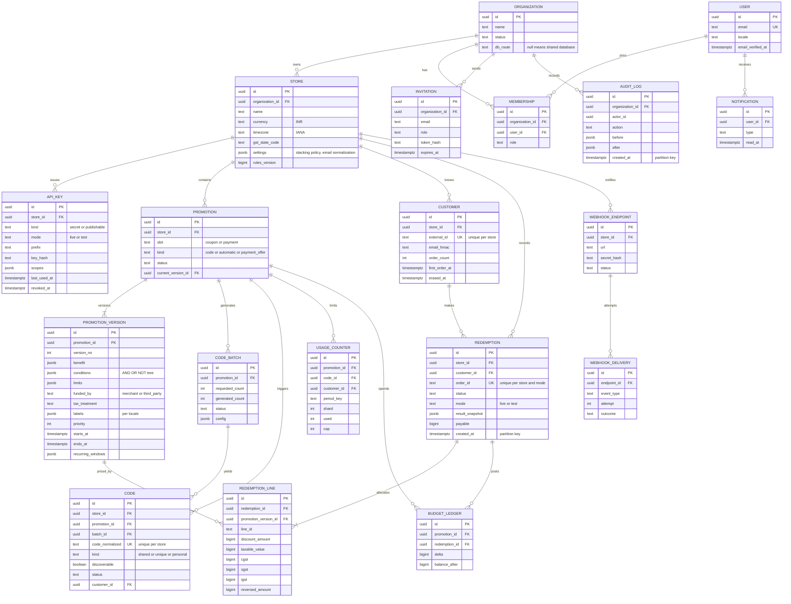

# Data model (draft)

Refined from the starting list in the brief. All tenant-owned tables carry `organization_id` and have row-level
security. Money columns are `bigint` paise. Timestamps are `timestamptz` (UTC).

Tables without drawn relationships (to keep the diagram readable): `events` (immutable, monthly partitions),
`outbox` (written in the business transaction, relayed by the worker), `idempotency_records`
(`store_id`, `key` unique, request hash, stored response, expiry), `notification_preferences`.

## Changes from the brief's starting list

| Change | Reason |
|---|---|
| `StackingGroup` replaced by `PROMOTION.slot` | You fixed the policy at one coupon plus one payment offer; a slot is simpler than groups |
| `Segment` deferred | The merchant does not send tags; customer facts come from the `CUSTOMER` ledger fields |
| `Job` dropped | `pg-boss` owns its own tables |
| `Plan`, `Subscription`, `UsageRecord` deferred | Billing is later; an entitlement interface exists in code |
| `FeatureFlag` deferred | Admin is CLI-only for now |
| Added `payment` conditions inside `PROMOTION_VERSION.conditions` | Payment offers match on method, issuer, network and card type only. Never card numbers or BINs (see compliance-india.md) |
| Added per-line tax columns in `REDEMPTION_LINE` | Needed for GST breakup and credit-note data |
| Users and sessions | Managed by the auth library's own tables; the `USER` entity above is the logical view |

## Key constraints and indexes (summary)

- `code(store_id, code_normalized)` unique. Codes are upper-cased and trimmed.
- `customer(store_id, external_id)` unique.
- `redemption(store_id, mode, order_id)` unique, so one order cannot redeem twice.
- `idempotency_records(store_id, key)` unique.
- `usage_counter` unique on `(promotion_id, code_id, customer_id, period_key, shard)`, with a `CHECK (used <= cap)` as a last line of defence.
- `promotion_version(promotion_id, version_no)` unique; rows are never updated (enforced by a trigger).
- `audit_log`, `budget_ledger`, `events`: append-only (update/delete blocked by trigger).
- Hot-path lookup indexes: `code` by `(store_id, code_normalized)`, active promotions by `(store_id, status, starts_at, ends_at)`.
